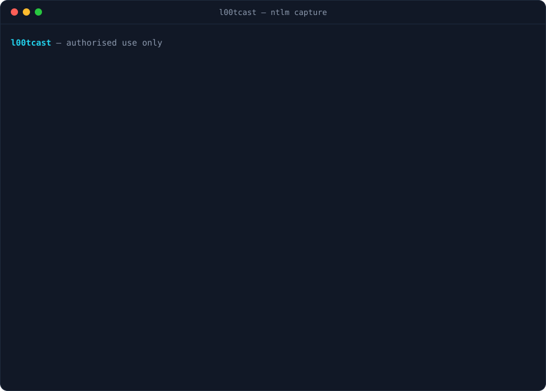

# l00tcast

[](https://github.com/grimh3xx/l00tcast/actions)
[](LICENSE)


**Poisoning de LLMNR/NBT-NS/mDNS e captura de NetNTLM em Rust**, alternativa
enxuta ao Responder para pentest autorizado. Responde às buscas de nome da LAN
apontando para você e coleta o hash NetNTLMv1/v2 já em **formato hashcat**.

<p align="center"></p>

> ## ⚠️ Uso autorizado apenas
> Poisoning de resolução de nome afeta **toda a LAN** e é intrusivo. Rode
> **somente** em redes que você possui ou tem **permissão escrita** para testar.
> Uso não autorizado é crime; a responsabilidade é sua.

## Módulos

| flag | o que faz |
|---|---|
| `--llmnr` | responde LLMNR (UDP 5355, 224.0.0.252) |
| `--mdns`  | responde mDNS (UDP 5353, 224.0.0.251) |
| `--nbtns` | responde NBT-NS (UDP 137, broadcast) |
| `--http`  | servidor que força NTLM e extrai o NetNTLM |

Sem flags, liga todos. Desafio do servidor fixo em `1122334455667788` para
cracking offline.

## Uso

```sh
sudo l00tcast -I 192.168.1.50                 # todos os módulos
sudo l00tcast -I 192.168.1.50 --llmnr --http  # só LLMNR + captura HTTP
sudo l00tcast -I 192.168.1.50 -o loot.txt     # grava hashes
```

A linha capturada sai pronta pro hashcat:

```sh
hashcat -m 5600 loot.txt wordlist.txt   # NetNTLMv2
```

## Roadmap

- Captura via **SMB** (rogue server) além de HTTP.
- WPAD/proxy e downgrade.

## Build

```sh
cargo build --release
```

## Licença

MIT. Veja [LICENSE](LICENSE).
