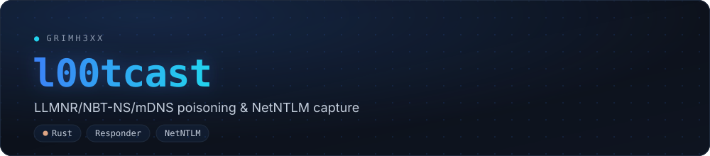

[](https://github.com/grimh3xx/l00tcast/actions)
[](LICENSE)


**LLMNR/NBT-NS/mDNS poisoning and NetNTLM capture in Rust**, a lean Responder
alternative for authorised pentests. It answers the LAN's name lookups pointing
them at you and collects the NetNTLMv1/v2 hash already in **hashcat format**.

<p align="center"></p>

> ## ⚠️ Authorised use only
> Name-resolution poisoning affects the **whole LAN** and is intrusive. Run
> **only** on networks you own or have **written permission** to test.

## Modules

| flag | what it does |
|---|---|
| `--llmnr` | answer LLMNR (UDP 5355, 224.0.0.252) |
| `--mdns`  | answer mDNS (UDP 5353, 224.0.0.251) |
| `--nbtns` | answer NBT-NS (UDP 137, broadcast) |
| `--http`  | HTTP server that forces NTLM and extracts the NetNTLM hash |

With no flags all are on. The server challenge is fixed to `1122334455667788`
for offline cracking.

## Usage

```sh
sudo l00tcast -I 192.168.1.50                 # all modules
sudo l00tcast -I 192.168.1.50 --llmnr --http  # LLMNR + HTTP capture only
sudo l00tcast -I 192.168.1.50 -o loot.txt     # save hashes
```

Captured lines are hashcat-ready:

```sh
hashcat -m 5600 loot.txt wordlist.txt   # NetNTLMv2
```

## Tests

```sh
cargo test --release
```

- Poisoning: a crafted LLMNR query must be answered with the attacker IP.
- NTLM: a synthetic NTLMv2 Type-3 must parse into the exact hashcat line.
- HTTP capture: an in-process NTLM client (Type1 -> 401 -> Type3) must have its
  hash written to the loot file.

## Roadmap

- NetNTLM capture over **SMB** (rogue server) in addition to HTTP.
- WPAD/proxy and downgrade.

## Build

```sh
cargo build --release
```

## License

MIT. See [LICENSE](LICENSE).
